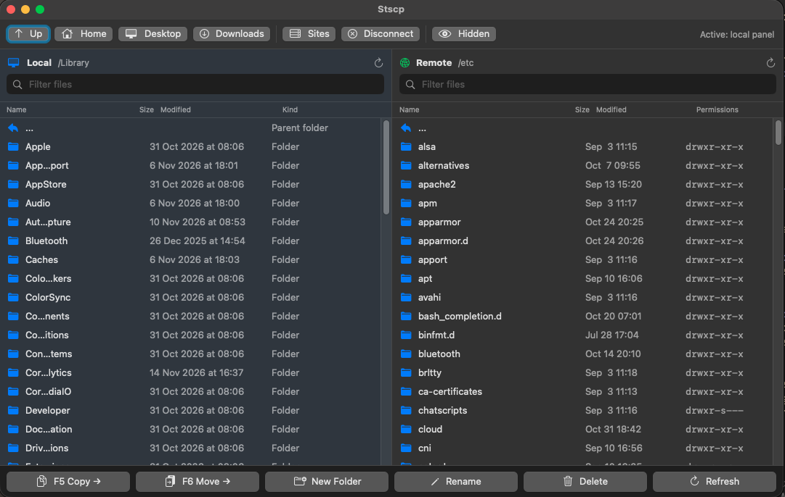

# Stscp

A native, lightweight WinSCP-style SFTP client for macOS, built with SwiftUI. Two panes: a local
file browser on the left, a remote SFTP browser on the right, with upload/download between them.

It's a Swift Package executable (no Xcode project needed), macOS 13+, Swift 6 tools version.



## Requirements

- macOS 13 Ventura or newer (Apple silicon or Intel).
- The system OpenSSH client (`ssh`, `scp`), which ships with macOS.
- SSH key / ssh-agent or password authentication (OpenSSH 8.4+ for passwords; macOS ships a newer one).
- A remote account with normal shell access.

## Installation

1. Download the latest `Stscp-<version>.dmg` from the
   [Releases](../../releases) page.
2. Open the DMG and drag **Stscp** into **Applications**.
3. Launch it.

The app is ad-hoc signed but **not notarized** by Apple, so Gatekeeper blocks the first launch.
To allow it, either:

- right-click (or Control-click) **Stscp** in Applications → **Open** → **Open**, or open
  **System Settings → Privacy & Security** and click **Open Anyway**; or
- remove the quarantine attribute from Terminal:

  ```bash
  xattr -dr com.apple.quarantine /Applications/Stscp.app
  ```

Saved sites are stored in `~/Library/Application Support/Stscp/sites.json`. They contain host,
port, user, authentication method, identity-file path and initial remote path, never passwords
or key contents.

### Password authentication

Choose **Password** as the method in the Site Manager and type the password before connecting.
The password is kept only in Stscp's memory until you quit the app, so reconnecting to the same
site during one session does not ask again. It is never written to `sites.json`, the Keychain or
any other file. A rejected password is forgotten immediately.

## How it talks SFTP

There's no embedded SSH library. Stscp shells out to the system's OpenSSH client (`ssh`,
`scp`) via `Process`:

- **Connect** starts a background `ssh -M` "control master" connection for the site, authenticated
  once. Key sites use SSH keys / ssh-agent with `BatchMode=yes`, so ssh never prompts. Password
  sites let ssh ask for the password through `SSH_ASKPASS`: a tiny helper script (containing no
  secret) prints it from an environment variable, so the password never appears in the command
  line visible through `ps`.
- Every subsequent operation (listing, mkdir, rm, mv, stat, upload, download) reuses that same
  authenticated connection via `-o ControlPath=...`, so there's no per-action reconnect cost.
- Directory listings are produced by running `ls -la` on the remote host and parsing the classic
  Unix long-listing format.
- Uploads/downloads run through `scp`. Since `scp`/`sftp` only show their progress meter when
  attached to a real terminal (not when piped from `Process`), Stscp approximates progress by
  polling the destination file's size every ~0.5s while the transfer is in flight.

**Implication:** the remote account needs normal shell access (used for
`ls`/`mkdir`/`rm`/`mv`/`stat`). SFTP-chroot-only accounts (no shell) and multi-step logins such as
one-time codes are not supported in this version.

## Security

Please do not report vulnerabilities in public issues. See [SECURITY.md](SECURITY.md).

## License

Licensed under the [Apache License, Version 2.0](LICENSE).
